<div align="center">

# 🌾 SIMKODES
### Sistem Informasi Manajemen Koperasi Desa Sranak

*Platform Digital Terpadu untuk Tata Kelola Administrasi, Anggota, Inventaris, dan Penyaluran Bantuan Koperasi Desa.*

[](https://laravel.com)
[](https://www.php.net/)
[](https://www.mysql.com/)
[](https://vitejs.dev/)
[](https://playwright.dev/)
[-brightgreen?style=for-the-badge&logo=githubactions&logoColor=white)](#-pengujian--quality-assurance-qa)
[](docs/prd/04_cicd_pipeline.md)
[](https://sentry.io/)

<br/>

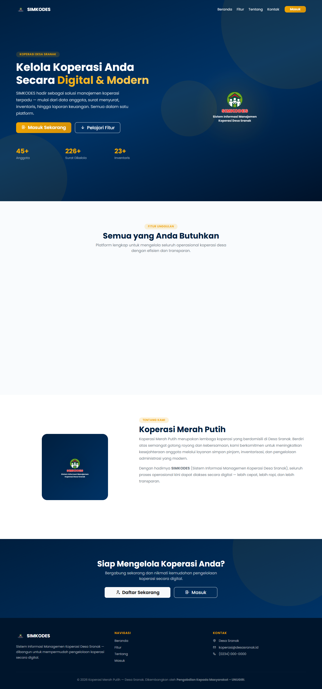

</div>

---

## 📖 Daftar Isi

1. [Tentang SIMKODES](#-tentang-simkodes)
2. [Tangkapan Layar & Galeri Antarmuka](#-tangkapan-layar--galeri-antarmuka)
3. [Fitur Unggulan](#-fitur-unggulan)
4. [Arsitektur & Spesifikasi Teknologi](#-arsitektur--spesifikasi-teknologi)
5. [Otomatisasi CI/CD & DevOps](#-otomatisasi-cicd--devops-7-workflow)
6. [Pengujian & Quality Assurance (QA)](#-pengujian--quality-assurance-qa)
7. [Panduan Instalasi & Menjalankan](#-panduan-instalasi--menjalankan)
8. [Dokumentasi Lengkap (PRD)](#-dokumentasi-lengkap-prd)
9. [Kontributor & Lisensi](#-kontributor--lisensi)

---

## 🌟 Tentang SIMKODES

**SIMKODES** adalah solusi perangkat lunak berbasis web yang dikembangkan khusus untuk memodernisasi tata kelola dan administrasi **Koperasi Desa Sranak**. Sistem ini menyelesaikan masalah pencatatan manual yang rentan hilang, mempercepat proses verifikasi data anggota, mengotomatisasi pencetakan Kartu Tanda Anggota (KTA) digital ber-barcode, serta menjamin transparansi penyaluran subsidi dan bantuan bagi warga desa.

Sistem dirancang mengadopsi standar **Clean Architecture**, API RESTful bersertifikasi Sanctum, performa query bebas masalah $N+1$, serta pipeline deployment terotomatisasi penuh menggunakan **7 Modular GitHub Actions Workflows**.

---

## 📸 Tangkapan Layar & Galeri Antarmuka

| Halaman & Fitur | Tampilan Antarmuka |
| :--- | :--- |
| **Dashboard Statistik Real-Time**<br/>Menampilkan ringkasan total anggota, pengurus, inventaris, arsip surat, serta grafik pertumbuhan bulanan. | 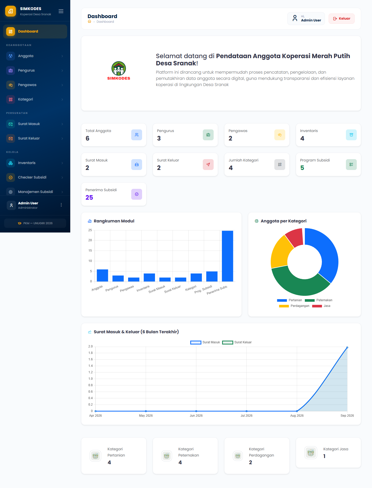 |
| **Master Data Anggota & KTA PDF**<br/>Manajemen database anggota koperasi dilengkapi generator cetak kartu fisik/digital otomatis. | 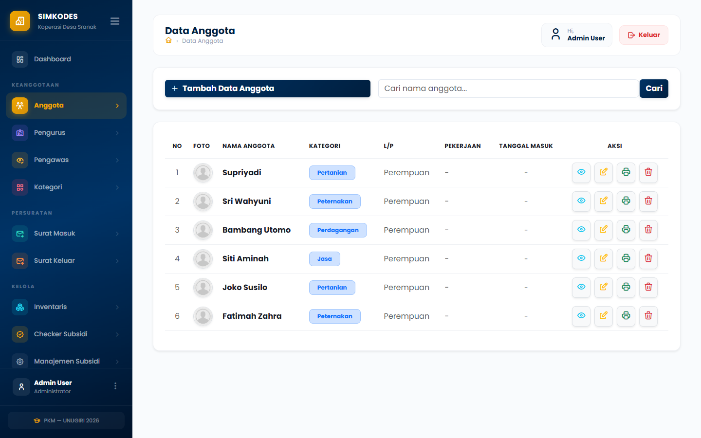<br/>*Kartu Tanda Anggota (KTA) Digital:*<br/>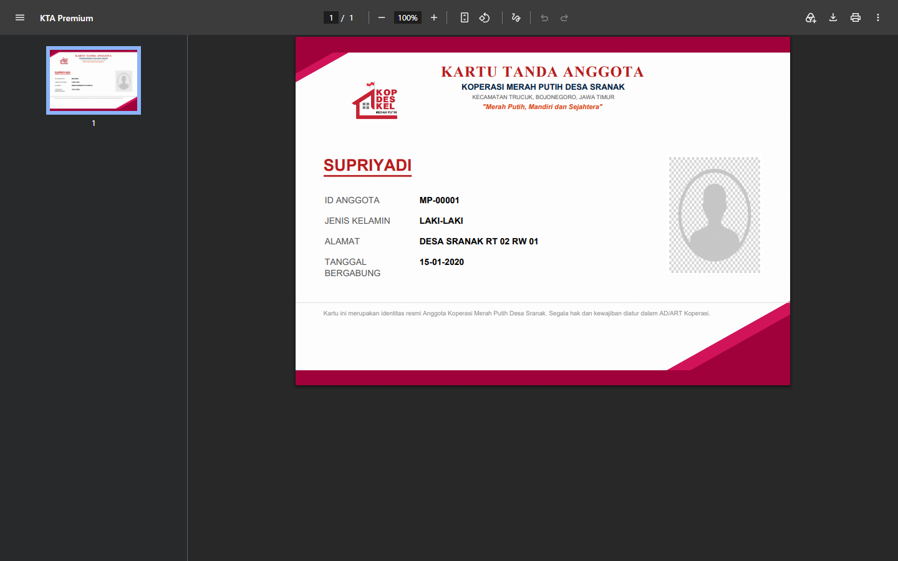 |
| **Manajemen Pengurus & Pengawas**<br/>Pencatatan jabatan, masa bakti, foto profil, dan tanda tangan digital pengurus koperasi. | 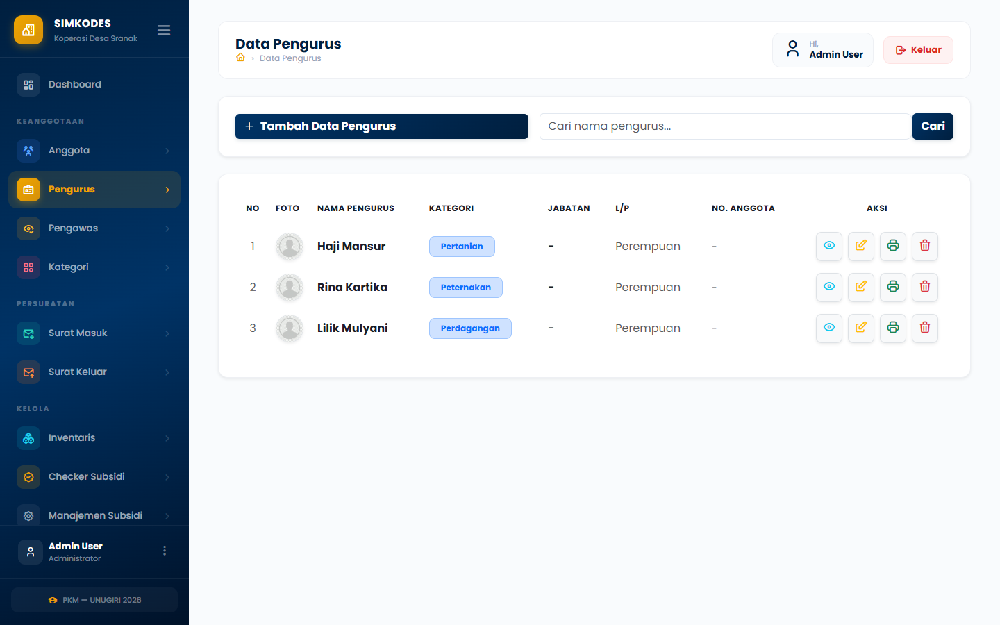 |
| **Pengarsipan Persuratan Digital**<br/>Pencatatan dan upload dokumen berkas surat masuk serta surat keluar koperasi desa. | 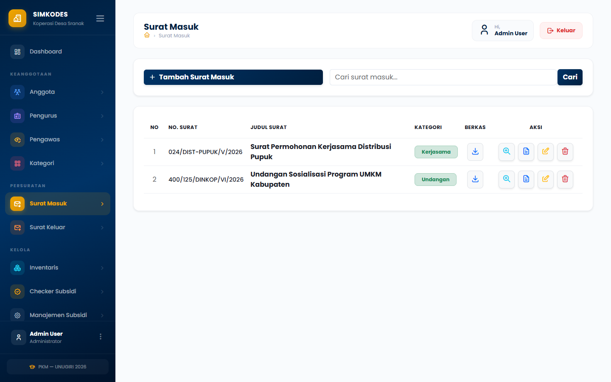<br/>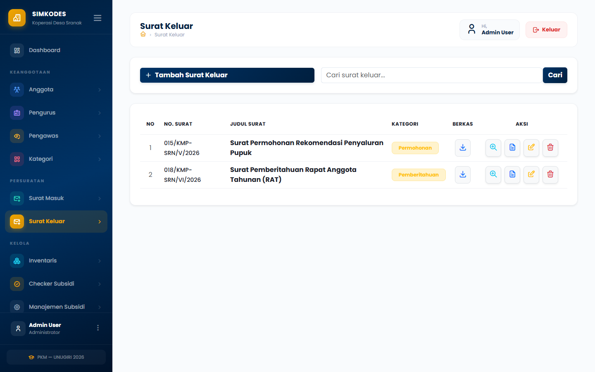 |
| **Buku Inventaris & Ekspor Dokumen**<br/>Pencatatan aset barang koperasi lengkap dengan fitur ekspor laporan ke format **PDF & Excel**. | 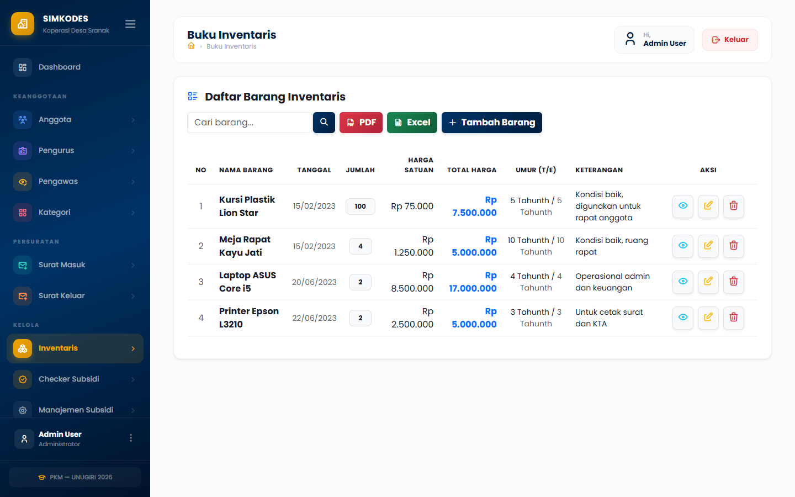 |
| **Penyaluran Subsidi & Rekapitulasi**<br/>Manajemen data penerima bantuan warga desa serta laporan distribusi bantuan per periode. | 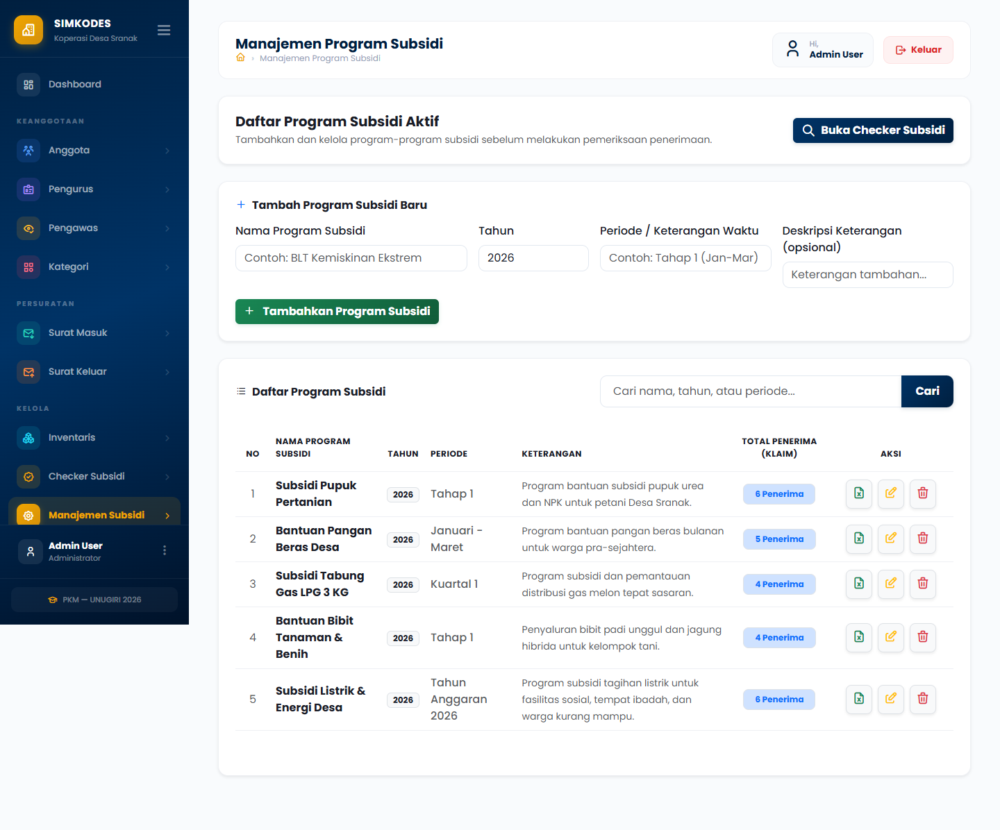 |
| **Layanan Publik: Cek Subsidi Mandiri**<br/>Fitur pencarian mandiri bagi warga desa untuk mengecek status penerima bantuan via NIK. | 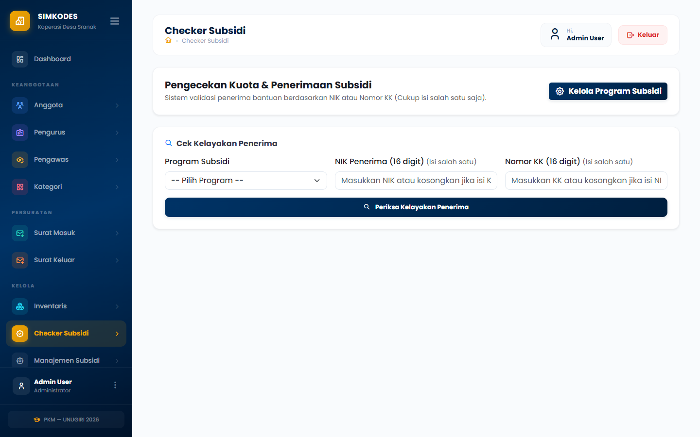 |
| **Autentikasi Terproteksi**<br/>Pintu masuk sistem dengan validasi keamanan sesi dan proteksi CSRF. | 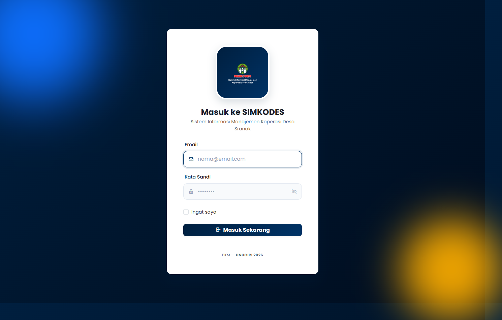 |

---

## ⚡ Fitur Unggulan

- **Identitas Digital Koperasi (KTA Generator)**: Menghasilkan kartu anggota berstandar cetak dengan kop resmi koperasi desa secara instan (*Dompdf*).
- **Arsip Digital Tanpa Kertas**: Manajemen surat masuk dan keluar terintegrasi dengan upload dokumen PDF/gambar langsung ke media storage.
- **Transparansi Bantuan Sosial**: Modul pengecekan NIK terisolasi yang memungkinkan warga memeriksa bantuan tanpa harus membuka data sensitif koperasi.
- **Ekspor Multi-Format**: Menyediakan laporan inventaris dan keuangan dalam format `.pdf` dan spreadsheet `.xlsx` via *Maatwebsite Excel*.
- **RESTful API Berstandar JSend**: Menyediakan endpoint `/api/*` terautentikasi Bearer Token Sanctum untuk integrasi aplikasi mobile / pihak ketiga.
- **Pencegahan N+1 Query**: Eager loading terproyeksi yang menjamin performa query database tetap optimal meski dataset anggota bertambah puluhan ribu baris.

---

## 🛠️ Arsitektur & Spesifikasi Teknologi

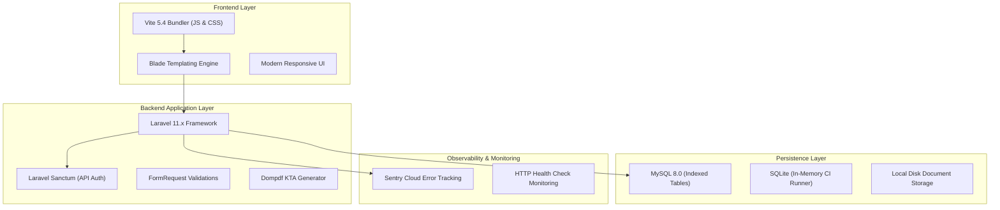

### Tech Stack Details:
- **Backend**: Laravel 11.x, PHP 8.2+
- **Frontend**: Blade, Vite 5.4, Vanilla JS / Alpine.js
- **Database**: MySQL 8.0 (Staging & Production) & SQLite (Testing / CI)
- **API Standard**: JSend Envelope (`success`, `code`, `message`, `data`, `meta`)
- **Hosting Environment**: Hostinger Shared Hosting (LiteSpeed Web Server)

---

## 🚀 Otomatisasi CI/CD & DevOps (7 Workflow)

Sistem mengadopsi prinsip *Single Responsibility Principle* dengan membagi alur operasional ke dalam **7 Workflow GitHub Actions modular**:

```text
.github/workflows/
├── ci.yml            # CI: 79 PHPUnit Tests & 12 Playwright E2E Scenarios
├── staging.yml       # CD: Otomatisasi Deploy Staging (dengan Dynamic Basic Auth)
├── production.yml    # CD: Live Production Deployment (Wajib Konfirmasi "DEPLOY")
├── maintenance.yml   # Ops: Remote Toggle php artisan down / up via SSH
├── backup.yml        # Ops: Terjadwal Mingguan & Manual MySQL Dump ke Artifacts (30 Hari)
├── security.yml      # Sec: Audit Keamanan Dependensi (composer audit & npm audit)
└── monitoring.yml    # Mon: Health Check Berkala Ping Status HTTP Staging & Production
```

> [!IMPORTANT]
> **Kebijakan Rilis Production:**
> Workflow `production.yml` berada dalam status **STANDBY / MANUAL ONLY** dan hanya dapat dipicu secara sengaja melalui dialog `workflow_dispatch` dengan mengetik konfirmasi `"DEPLOY"`. Tidak ada rilis otomatis tanpa persetujuan tim koperasi.

---

## 🧪 Pengujian & Quality Assurance (QA)

SIMKODES menerapkan strategi pengujian berlapis yang menguji 100% alur fungsional, integrasi, efisiensi query, dan tampilan browser.

```
Total: 91 Pengujian Otomatis Lulus (100% PASS)
├── PHPUnit Feature & Unit Tests    : 79 passed (468 assertions)
└── Playwright E2E Browser Tests    : 12 passed (7 test specs)
```

### Matriks Kepatuhan 7 Standar QA:
| Standar QA | Status | Bukti Implementasi di SIMKODES |
| :--- | :---: | :--- |
| **1. Code Quality** | **Lulus** | Clean Code, FormRequests terpisah, kontrak paginasi resmi, JSend Envelope via `ApiResponseTrait`. |
| **2. Unit Testing** | **Lulus** | Pengujian logika formatting tanggal agnostik database (SQLite `strftime` vs MySQL `DATE_FORMAT`). |
| **3. Integration Testing** | **Lulus** | Pengujian siklus Bearer Token Sanctum, upload/download berkas surat, integrasi Sentry Cloud (`SIMKODES-1`). |
| **4. Feature & E2E Testing** | **Lulus** | 79 Feature tests (10 modul CRUD) + 12 Playwright E2E browser automation tests. |
| **5. Security Testing** | **Lulus** | Workflow `security.yml` memindai CVE via `composer audit --locked` & `npm audit`, CSRF protection, Basic Auth staging. |
| **6. Performance Testing** | **Lulus** | Bebas N+1 query (`QueryEfficiencyTest`), indexing database, aset bundling Vite, `php artisan optimize`. |
| **7. User Acceptance (UAT)**| **Staging** | Lingkungan staging aktif di `https://simkodes-staging.sranak.com` siap untuk verifikasi langsung oleh pengurus. |

---

## 💻 Panduan Instalasi & Menjalankan

### Opsi A: Menggunakan Docker Compose (Sangat Direkomendasikan)

1. **Clone repository dan siapkan konfigurasi:**
   ```bash
   git clone https://github.com/muhamadrofii/simkodes.git
   cd simkodes
   cp .env.docker.example .env
   ```

2. **Jalankan container Docker:**
   ```bash
   docker compose up -d --build
   ```

3. **Inisialisasi dependensi dan database:**
   ```bash
   docker compose exec app composer install
   docker compose exec app php artisan key:generate
   docker compose exec app php artisan migrate --seed
   docker compose exec app php artisan storage:link
   ```

4. **Buka aplikasi:**
   - **Aplikasi Web SIMKODES**: [http://localhost:8000](http://localhost:8000)
   - **Database Management (phpMyAdmin)**: [http://localhost:8080](http://localhost:8080)
     *(User: `simkodes_user` | Password: `simkodes_password`)*

---

### Opsi B: Instalasi Lokal (Tanpa Docker)

1. **Pastikan Prasyarat Terpenuhi:**
   - PHP $\ge$ 8.2 (dengan ekstensi `pdo_mysql`, `mbstring`, `fileinfo`, `intl`, `gd`)
   - Composer $\ge$ 2.5
   - Node.js $\ge$ 20 & NPM
   - MySQL Server $\ge$ 8.0

2. **Install Dependensi & Kompilasi Aset:**
   ```bash
   composer install
   npm install
   npm run build
   ```

3. **Konfigurasi Environment & Database:**
   ```bash
   cp .env.example .env
   php artisan key:generate
   ```
   *Sesuaikan pengaturan koneksi database `DB_*` di berkas `.env`.*

4. **Migrasi Database & Buat Symlink Storage:**
   ```bash
   php artisan migrate --seed
   php artisan storage:link
   ```

5. **Jalankan Development Server:**
   ```bash
   php artisan serve
   ```
   *Aplikasi dapat diakses di [http://127.0.0.1:8000](http://127.0.0.1:8000).*

---

### 🧪 Menjalankan Rangkaian Pengujian

```bash
# 1. Menjalankan seluruh test backend PHPUnit (Feature, Unit, API)
php artisan test

# 2. Menjalankan pengujian efisiensi SQL dan RESTful API saja
php artisan test --filter=Api

# 3. Menjalankan pengujian Browser E2E Playwright
npx playwright test

# 4. Menjalankan Playwright dengan antarmuka visual (Interactive UI)
npx playwright test --ui
```

---

## 📚 Dokumentasi Lengkap (PRD)

Dokumentasi arsitektur sistem dan spesifikasi teknis lengkap disusun secara modular di direktori [docs/prd/](docs/prd/):

* [**01. Product Overview**](docs/prd/01_product_overview.md) — Visi, misi, profil aktor pengguna, dan ruang lingkup modul.
* [**02. Code Architecture**](docs/prd/02_code_architecture.md) — Pola Clean Architecture, RESTful API Sanctum, dan Form Requests.
* [**03. Testing Strategy**](docs/prd/03_testing_strategy.md) — Strategi piramida pengujian, Playwright POM, dan matriks 7 standar QA.
* [**04. CI/CD Pipeline**](docs/prd/04_cicd_pipeline.md) — Arsitektur 7 workflow GitHub Actions, multi-secret fallback, dan DevOps matrix.
* [**05. DevOps Infrastructure**](docs/prd/05_devops_infrastructure.md) — Konfigurasi Hostinger LiteSpeed, port custom 65002, dan mitigasi symlink.
* [**06. Database Optimization**](docs/prd/06_database_optimization.md) — Indeks SQL performa, eliminasi N+1 query, dan multi-driver MySQL/SQLite.
* [**07. Monitoring & Maintenance**](docs/prd/07_monitoring_maintenance.md) — Sentry error tracking, automated backup 30 hari, dan SOP cutover rilis.

---

## 👥 Kontributor & Lisensi

Proyek ini dikembangkan dan dikelola oleh **Muhamad Rofii** untuk **Koperasi Desa Sranak**.  
Didistribusikan di bawah lisensi internal Koperasi Desa Sranak. Seluruh hak cipta dilindungi undang-undang.
