# 🚀 PRD 04: CI/CD Pipeline & GitHub Actions Automation

## 1. Arsitektur Otomatisasi CI/CD
SIMKODES menerapkan strategi **Continuous Integration (CI)** dan **Continuous Deployment (CD)** menggunakan GitHub Actions untuk menjamin setiap baris kode yang di-push ke repository telah teruji secara otomatis sebelum di-deploy ke server hosting.

```mermaid
flowchart LR
    A["Developer Push / PR"] --> B["GitHub Actions CI (e2e.yml)"]
    B --> C["1. Setup PHP 8.2 & Node.js 20"]
    C --> D["2. SQLite In-Memory Database"]
    D --> E["3. Run PHPUnit (79 Tests)"]
    E --> F["4. Run Playwright E2E (12 Tests)"]
    F -->|Tests Pass| G["Merge to master / staging"]
    G --> H["GitHub Actions CD (deploy-staging.yml)"]
    H --> I["Build Vite & Composer"]
    I --> J["Inject Dynamic .htpasswd"]
    J --> K["Rsync over SSH to Hostinger"]
    K --> L["Post-Deploy: ln -sfn storage & optimize"]
```



---

## 2. Pipeline Continuous Integration ([.github/workflows/e2e.yml](file:///c:/code/sranak/simkodes/.github/workflows/e2e.yml))

### A. Pemicu (Triggers)
- Push ke branch `master` atau `staging`.
- Pull Request ke branch `master` atau `staging`.
- Trigger manual via `workflow_dispatch`.

### B. Tahapan Eksekusi (Steps)
1. **Checkout Code**: Mengambil salinan source code repository.
2. **Setup PHP 8.2**: Menginstal ekstensi penting (`mbstring`, `pdo_sqlite`, `sqlite3`, `intl`, `bcmath`, `fileinfo`).
3. **Setup Node.js 20**: Menyiapkan environment Node dengan caching NPM aktif.
4. **Install Dependencies**: Menjalankan `composer install` dan `npm ci`.
5. **Build Asset Frontend**: Menjalankan `npm run build` untuk kompilasi Vite JS & CSS.
6. **Setup SQLite Test DB**:
   - Menyiapkan database file `database/database.sqlite`.
   - Mengubah `DB_CONNECTION=sqlite` secara dinamis.
   - Menjalankan migrasi dan seeder: `php artisan migrate --seed --force`.
7. **Eksekusi PHPUnit Test Suite**: Menjalankan seluruh 79 pengujian backend, REST API, dan efisiensi query.
8. **Install Playwright Chromium**: Mengunduh headless browser Chromium beserta dependensi OS Linux.
9. **Eksekusi Playwright E2E**: Menjalankan 12 skenario pengujian antarmuka dengan auto-webserver.
10. **Upload Artifact Laporan (Jika Gagal)**: Otomatis mengunggah rekaman video, screenshot, dan trace Playwright jika terjadi kegagalan tes.

---

## 3. Pipeline Continuous Deployment ([.github/workflows/deploy-staging.yml](file:///c:/code/sranak/simkodes/.github/workflows/deploy-staging.yml))

### A. Pemicu (Triggers)
- Push ke branch `master` atau trigger manual `workflow_dispatch`.

### B. Otomatisasi Keamanan (Dynamic HTTP Basic Auth)
Untuk melindungi lingkungan Staging agar tidak dapat dibuka oleh publik umum, workflow menginjeksi proteksi autentikasi dasar ke `.htaccess` secara otomatis sebelum proses rsync:
```bash
# Menghasilkan hash kata sandi terenkripsi
HTPASSWD_HASH=$(openssl passwd -apr1 "${{ secrets.STAGING_AUTH_PASS }}")
echo "${{ secrets.STAGING_AUTH_USER }}:${HTPASSWD_HASH}" > .htpasswd

# Menginjeksi aturan Apache Basic Auth ke file .htaccess publik
sed -i "1i AuthType Basic\nAuthName \"Restricted Staging Access\"\nAuthUserFile /home/u849825724/domains/sranak.com/public_html/simkodes-staging/public/.htpasswd\nRequire valid-user\n" public/.htaccess
```

### C. Deployment via Rsync over SSH
- Menggunakan SSH Key khusus `hostinger_simkodes`.
- Mentransfer hanya file yang berubah (*delta transfer*).
- Menghindari overwrite file sensitif di server dengan parameter eksklusi:
  `--exclude='.env'`, `--exclude='storage/app/public/'`, `--exclude='_archive/'`, `--exclude='.git/'`.

### D. Post-Deployment Execution (Hostinger Compatibility)
Setelah transfer file selesai, workflow mengeksekusi serangkaian perintah via SSH:
1. **Pembuatan Direktori Cache**:
   ```bash
   mkdir -p storage/framework/{views,cache,sessions} storage/logs
   chmod -R 775 storage bootstrap/cache
   ```
2. **Bypass Batasan `symlink()` Hostinger**:
   ```bash
   cd public && ln -sfn ../storage/app/public storage || true
   ```
3. **Pembersihan Cache Produksi**:
   ```bash
   php artisan optimize:clear
   php artisan config:cache
   php artisan route:cache
   php artisan view:cache
   ```

---

## 4. Daftar Kunci Rahasia (GitHub Repository Secrets)

| Nama Secret | Deskripsi / Nilai |
| :--- | :--- |
| `HOSTINGER_SSH_HOST` | IP Address server Hostinger (`195.35.48.228`) |
| `HOSTINGER_SSH_USER` | Akun SSH cPanel Hostinger (`u849825724`) |
| `HOSTINGER_SSH_PORT` | Port SSH custom Hostinger (`65002`) |
| `HOSTINGER_SSH_KEY` | Private SSH Key OpenSSH (`hostinger_simkodes`) |
| `STAGING_AUTH_USER` | Username untuk login HTTP Basic Auth Staging |
| `STAGING_AUTH_PASS` | Password untuk login HTTP Basic Auth Staging |
| `SENTRY_LARAVEL_DSN` | DSN koneksi cloud error tracking Sentry |
