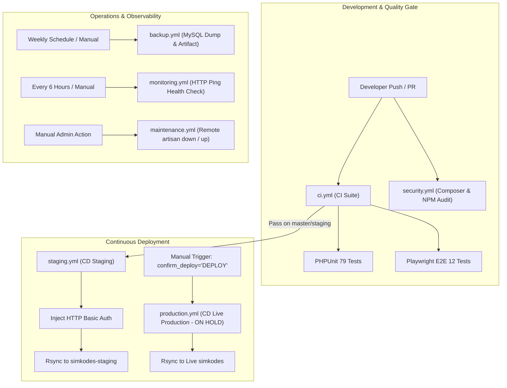

# 🚀 PRD 04: Arsitektur Modular 7 Workflow GitHub Actions & DevOps

## 1. Ikhtisar Arsitektur Workflow
SIMKODES menggunakan sistem otomatisasi **7 workflow modular terpisah** di direktori `.github/workflows/` yang masing-masing memiliki tanggung jawab tunggal (*Single Responsibility Principle*):

```text
.github/
└── workflows/
    ├── ci.yml            # CI: PHPUnit, REST API, & Playwright E2E Tests
    ├── staging.yml       # CD: Otomatisasi deploy ke Staging Server (dengan Basic Auth)
    ├── production.yml    # CD: Deploy manual ke Live Production (Proteksi Konfirmasi "DEPLOY")
    ├── maintenance.yml   # Ops: Remote toggle php artisan down / up via SSH
    ├── backup.yml        # Ops: Terjadwal & manual mysqldump remote ke GitHub Artifacts
    ├── security.yml      # Sec: task-b1 (composer audit --locked & npm audit)
    └── monitoring.yml    # Mon: Health check berkala ping HTTP status staging & production
```



---

## 2. Rincian 7 Workflow GitHub Actions

### A. [ci.yml](file:///c:/code/sranak/simkodes/.github/workflows/ci.yml) — Continuous Integration
- **Pemicu**: `push` & `pull_request` ke branch `master` & `staging`, serta `workflow_dispatch`.
- **Fungsi**:
  1. Setup PHP 8.2 & Node.js 20.
  2. Setup In-Memory / File SQLite DB (`php artisan migrate --seed --force`).
  3. Menjalankan 79 pengujian PHPUnit (Unit, Feature, API, Query Efficiency N+1).
  4. Menjalankan 12 skenario Playwright E2E headless Chromium.
  5. Mengunggah artefak laporan Playwright jika terjadi kegagalan (*retention 7 hari*).

### B. [staging.yml](file:///c:/code/sranak/simkodes/.github/workflows/staging.yml) — Continuous Deployment Staging
- **Pemicu**: `push` ke branch `master` & `staging`, atau `workflow_dispatch`.
- **Fungsi**:
  1. Build aset frontend produksi (`npm run build`) dan kompilasi autoloader Composer (`--no-dev --optimize-autoloader`).
  2. Injeksi dinamis proteksi HTTP Basic Auth ke `.htaccess` dan file `.htpasswd` via `openssl passwd -apr1`.
  3. Rsync file ke folder staging Hostinger (`simkodes-staging/`).
  4. Post-deploy via SSH: permission `chmod 775`, symlink shell fix `ln -sfn`, migrasi DB staging, dan caching produksi (`config:cache`, `route:cache`, `view:cache`).

### C. [production.yml](file:///c:/code/sranak/simkodes/.github/workflows/production.yml) — Continuous Deployment Production (ON HOLD)
- **Status**: **STANDBY / DITAHAN** (Menunggu persetujuan UAT pengurus koperasi).
- **Pemicu**: **Hanya `workflow_dispatch` (Manual)** dengan parameter `confirm_deploy` wajib bernilai `"DEPLOY"`. Tidak akan pernah ter-deploy secara otomatis dari push maupun PR.
- **Fungsi**:
  1. Validasi string konfirmasi `"DEPLOY"`.
  2. Build aset produksi murni tanpa Basic Auth.
  3. Rsync ke direktori live `public_html/simkodes/`.
  4. Eksekusi `php artisan migrate --force` dan `php artisan optimize`.

### D. [maintenance.yml](file:///c:/code/sranak/simkodes/.github/workflows/maintenance.yml) — Kontrol Maintenance Mode Remote
- **Pemicu**: `workflow_dispatch` (Manual).
- **Parameter**:
  - `target`: `staging` atau `production`.
  - `action`: `down` (Aktifkan maintenance) atau `up` (Nonaktifkan maintenance).
  - `secret`: Token rahasia untuk bypass URL admin (`?secret=TOKEN`).
  - `retry_after`: Header `Retry-After` HTTP 503 (default: `3600` detik).
- **Fungsi**: Mengeksekusi `php artisan down --secret=...` atau `php artisan up` langsung di server Hostinger via SSH.

### E. [backup.yml](file:///c:/code/sranak/simkodes/.github/workflows/backup.yml) — Database Backup Automation
- **Pemicu**: Terjadwal mingguan (`cron: '0 2 * * 0'`) & `workflow_dispatch`.
- **Parameter**: `target`: `production` atau `staging`.
- **Fungsi**:
  1. Mengekstrak kredensial database target dari `.env` di server secara otomatis.
  2. Menjalankan `mysqldump --single-transaction --quick` dan mengompresnya ke `.sql.gz`.
  3. Mengunduh dump ke runner GitHub Actions via SCP.
  4. Mengunggah dump database sebagai GitHub Actions Artifact resmi melalui output step (`steps.dump.outputs.filename`) dengan masa simpan **30 hari**.

### F. [security.yml](file:///c:/code/sranak/simkodes/.github/workflows/security.yml) — Security & Dependency Audit (task-b1)
- **Pemicu**: `push`, `pull_request`, terjadwal mingguan (`cron: '0 3 * * 1'`), dan `workflow_dispatch`.
- **Fungsi**:
  1. `composer audit --locked`: Memindai kerentanan keamanan pada paket PHP langsung dari `composer.lock` tanpa perlu `composer install`.
  2. `npm audit --audit-level=high`: Memindai dependensi Node.js / frontend untuk kerentanan level High & Critical.
  3. Menggunakan `continue-on-error: true` dan mencatat ringkasan status audit ke GitHub Actions Step Summary serta anotasi peringatan (`::warning::`).

### G. [monitoring.yml](file:///c:/code/sranak/simkodes/.github/workflows/monitoring.yml) — Health Check & Uptime Monitoring
- **Pemicu**: Terjadwal setiap 6 jam (`cron: '0 */6 * * *'`) dan `workflow_dispatch`.
- **Fungsi**:
  1. Pengecekan HTTP endpoint Staging (`https://simkodes-staging.sranak.com`) dengan kredensial Basic Auth.
  2. Pengecekan HTTP endpoint Live Production (`https://simkodes.sranak.com`).
  3. Menampilkan matriks status uptime dan response code HTTP ke Step Summary.

---

## 3. Arsitektur Multi-Secret Fallback & Job-Level `env:` Context

Untuk mencegah error `Bad port '-H'` dan warning linter skema YAML di VS Code (*Context access might be invalid*), seluruh workflow yang menggunakan koneksi SSH mengadopsi pola deklarasi berikut:

### A. Deklarasi di Level Job `env:`
```yaml
jobs:
  deploy-staging:
    runs-on: ubuntu-latest
    env:
      SSH_PORT: ${{ secrets.HOSTINGER_SSH_PORT || secrets.SSH_PORT || '65002' }}
      SSH_HOST: ${{ secrets.HOSTINGER_SSH_HOST || secrets.SSH_HOST || '195.35.48.228' }}
      SSH_USER: ${{ secrets.HOSTINGER_SSH_USER || secrets.SSH_USER || 'u849825724' }}
```

### B. Matriks Kredensial & Nilai Fallback

| Kunci Konfigurasi | Nama Secret Utama | Nama Secret Alternatif | Nilai Default Fallback |
| :--- | :--- | :--- | :--- |
| **Port SSH** | `HOSTINGER_SSH_PORT` | `SSH_PORT` | `65002` (Port custom Hostinger) |
| **Host / IP Server** | `HOSTINGER_SSH_HOST` | `SSH_HOST` | `195.35.48.228` |
| **User SSH** | `HOSTINGER_SSH_USER` | `SSH_USER` | `u849825724` |
| **Private SSH Key** | `HOSTINGER_SSH_KEY` | `SSH_PRIVATE_KEY` | *(Wajib ada di Secrets)* |
| **Staging User** | `STAGING_AUTH_USER` | - | `simkodes_staging` |
| **Staging Pass** | `STAGING_AUTH_PASS` | - | *(Wajib ada di Secrets)* |
| **Sentry DSN** | `SENTRY_LARAVEL_DSN` | - | *(Wajib ada di Secrets)* |
